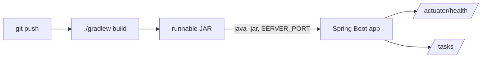

# tutorial-spring-boot-api

[](https://console.light-cloud.com/new?repo=https://github.com/light-cloud-com/tutorial-spring-boot-api)

A small Spring Boot 4 API used in the Light Cloud tutorial
[Spring Boot on Light Cloud: JAR, port and memory settings](https://blog.light-cloud.com/tutorials/deploy-a-spring-boot-app).



## Run it

```sh
./gradlew bootRun
curl localhost:8080/actuator/health
```
